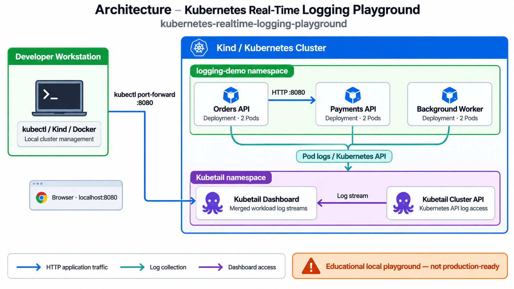

<p align="center"></p>

<h1 align="center">Kubernetes Real-Time Logging Playground</h1>
<p align="center">A reproducible Kind lab for multi-pod log aggregation with Kubetail.</p>
<p align="center"><strong>Educational playground — not production-ready.</strong></p>

<p align="center">


</p>

## Overview

This playground demonstrates real-time log aggregation across multiple Kubernetes replicas using [Kubetail](https://github.com/kubetail-org/kubetail). It creates a three-node Kind cluster and deploys six application pods:

- `orders-api`: two replicas receiving HTTP requests.
- `payments-api`: two replicas called by Orders.
- `background-worker`: two replicas producing periodic background-job logs.

Orders and Payments emit structured JSON logs with the same correlation ID, making cross-service request flows easy to inspect. The worker keeps the log stream active without manual traffic.

## Architecture

<p align="center"></p>

## Components

| Component | Technology | Purpose |
|---|---|---|
| Local cluster | Kind | Three Docker-backed Kubernetes nodes |
| Log dashboard | Kubetail | Merged real-time workload logs |
| Sample services | Python 3.12 | Structured JSON logs |
| Container runtime | Docker | Build and load the sample image |

## Objective

- Aggregate logs from multiple replicas in one chronological view.
- Follow a request across services using a correlation ID.
- Observe pod replacement and scaling.
- Compare logs from multiple workloads.
- Understand Kubernetes API log collection and Kubetail's optional cluster-side components.

## Prerequisites

Docker Engine/Desktop, `kind`, `kubectl`, `helm`, `curl`, Bash, and internet access to pull images and the Kubetail chart. Scripts target macOS/Linux or WSL.

## Installation

```bash
git clone https://github.com/openmind-systems-lab/kubernetes-realtime-logging-playground.git
cd kubernetes-realtime-logging-playground
kind create cluster --config k8s/kind-config.yaml
./scripts/build-load.sh
./scripts/deploy-apps.sh
```

Wait for all three Deployments to become Ready. Expected topology: six application pods.

## Quick Start

Install Kubetail using its official Helm chart:

```bash
helm repo add kubetail https://kubetail-org.github.io/helm-charts/
helm repo update
helm upgrade --install kubetail kubetail/kubetail --namespace kubetail --create-namespace
kubectl get pods -n kubetail
```

Expose the dashboard:

```bash
kubectl port-forward -n kubetail svc/kubetail-dashboard 8080:8080
```

Open [http://localhost:8080](http://localhost:8080), select namespace `logging-demo`, and inspect the three workloads.

Generate correlated traffic in another terminal:

```bash
./scripts/demo.sh
```

https://github.com/user-attachments/assets/1d538e6e-8dbb-4f18-91a4-c00cc89d908f

## Verification

```bash
./scripts/verify.sh
kubectl get deployments,pods,services -n logging-demo
kubectl get pods -n kubetail
```

In Kubetail, inspect both replicas of each workload. A request should produce matching `correlation_id` values in Orders and Payments logs.

## Experiments

Run `./scripts/demo.sh`, then search for a `correlation_id` and compare Orders and Payments streams.

### Observe pod replacement

```bash
kubectl delete pod -n logging-demo \
  "$(kubectl get pods -n logging-demo -l app=orders-api -o jsonpath='{.items[0].metadata.name}')"
```

https://github.com/user-attachments/assets/5a5783e9-cdfb-4089-8d98-eeaaaaec2cd8

Observe the Deployment create a replacement and the workload log stream continue across pod lifecycles.

### Scale a workload

```bash
kubectl scale deployment/payments-api -n logging-demo --replicas=4
kubectl get pods -n logging-demo -l app=payments-api -w
kubectl scale deployment/payments-api -n logging-demo --replicas=2
```

### Compare workloads

Inspect `orders-api`, `payments-api`, and `background-worker` separately, then compare timestamps and structured fields.

## Testing

```bash
./scripts/verify.sh
```

https://github.com/user-attachments/assets/7b52ca22-d60b-4f30-85ca-8e620bd40e82

## Cleanup

```bash
./scripts/cleanup.sh
kind delete cluster --name kubetail-lab
```

## What You Will Learn

- Kubernetes Deployments, Services, labels and selectors.
- Multi-replica log aggregation and pod lifecycle changes.
- Correlation IDs for cross-service request tracking.
- Kubernetes API-based log collection and optional node-level log agents.
- Installing and accessing a Kubernetes dashboard with Helm.

## References

- [Kubetail repository](https://github.com/kubetail-org/kubetail)
- [Kubetail documentation](https://docs.kubetail.com/)
- [Kubetail architecture](https://docs.kubetail.com/concepts/architecture)
- [Kubetail cluster installation](https://docs.kubetail.com/guides/cluster/installation)
- [Kind documentation](https://kind.sigs.k8s.io/)
- [Kubernetes documentation](https://kubernetes.io/docs/)

## 🏛 About OpenMind Systems Lab

OpenMind Systems Lab is an independent French non-profit association dedicated to research, experimental development and technical benchmarking in Cloud Native technologies.

Our mission is to produce practical, reproducible and educational Open Source Proofs of Concept covering Kubernetes, Platform Engineering, Distributed Messaging, Infrastructure Security and Artificial Intelligence.

GitHub Organization:

https://github.com/openmind-systems-lab

---

<p align="center">
Made with ❤️ by OpenMind Systems Lab
</p>
